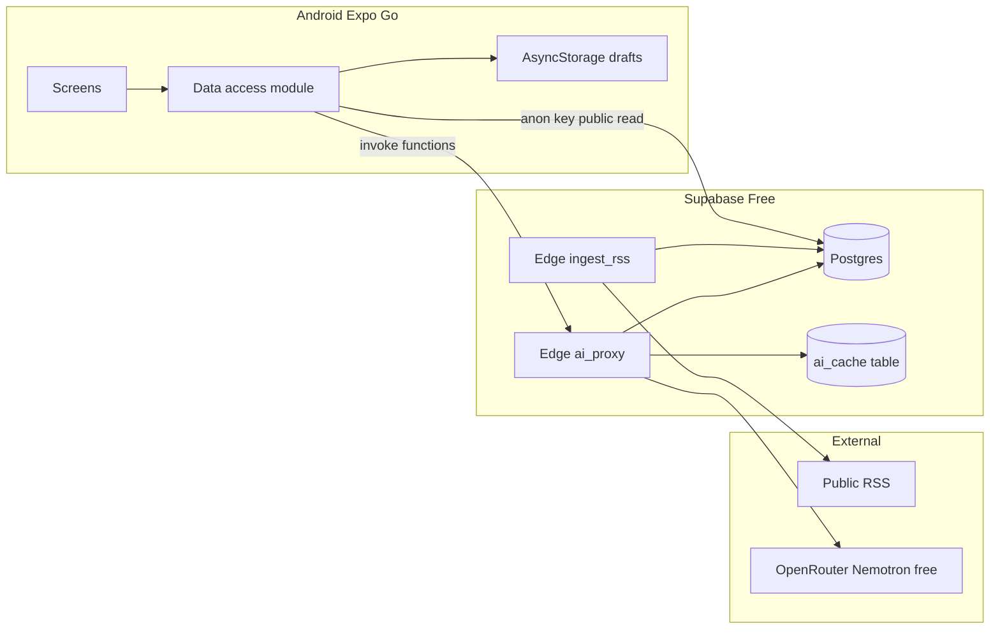

# VOICE Pulse MVP Plan

## Overview
A 10-day, $0 Congressional App Challenge MVP for VOICE Pulse: an Android Expo app that takes a student from a local O’Fallon / St. Charles County issue through civic Q&A, verified officials, and an editable saved advocacy draft. AI runs only on the server via OpenRouter’s free Nemotron 3 Ultra route, with cached demo responses so the video still works when the free quota or upstream provider fails.

## Goals
- Deliver a full demo loop in under 10 days
- Keep the app free to build and run
- Show a trustworthy local-civic journey without user auth
- Use AI only on the server with clear grounding labels
- Build a demo-safe architecture that handles provider failures

## Competition context
- Congressional App Challenge due October 26, 2026
- Demo is a 1–3 minute public video plus written answers
- The final app must be original student work with clear disclosure of AI usage
- AI can assist with development, but it cannot be the only technical driver

## Confirmed vs assumed
### Confirmed
- Geography: O’Fallon, MO and St. Charles County
- Android demo only
- Local issue feed, civic companion, officials, advocacy builder
- No auth required in MVP
- AI priority is issue-scoped Q&A
- OpenRouter model: `nvidia/nemotron-3-ultra-550b-a55b:free`

### Proposed and recommended
- Skip auth in Phase 1 and keep drafts local
- Cache every AI response
- Use Expo Router with React Native Paper
- Do not build a marketing website before the app is complete

## MVP deliverables
### Required screens
1. Home / issue feed
2. Issue detail (sources + Ask VOICE)
3. Civic companion (issue-scoped Q&A)
4. Officials list (filtered by issue/jurisdiction)
5. Official detail (verified contacts)
6. Advocacy editor (AI draft, fully editable)
7. Saved actions / drafts (local)

### Functional requirements
- Show 5–15 local issues with title, source, date, and original URL
- Never invent articles, quotes, officials, or citations
- Use accessible language and label answer source types
- Map issues to offices using curated tags, not model guesswork
- Generate an editable message and save or copy it
- Fall back to seed data and cached responses when network or AI is unavailable

## Feature matrix
### P0 essential
- Local news feed
- Source attribution and links
- Civic companion Q&A
- Officials directory
- Advocacy builder
- Local draft save
- App shell and error/offline states

### P1 if time
- Summary features
- Saved issue list
- Optional auth later
- Manual RSS refresh

### P2 deferred
- Multi-source comparison
- VOICE Hub
- Campaigns
- iOS polish
- Auto-emailing officials
- Multiple AI providers

## Architecture decision record
### Stack
- Expo SDK + React Native + TypeScript
- Expo Router
- React Native Paper + lucide-react-native
- Supabase Free for DB and Edge Functions
- OpenRouter free model for AI
- Curated JSON seed + RSS feeds
- GitHub for version control
- Figma for wireframes

### Failure model
- Supabase projects can pause after inactivity
- OpenRouter rate limits can hit 429 errors
- News and officials can become stale if not verified
- The app must degrade gracefully to cached data and templates

## System architecture

## Core data model
### `news_sources`
- id, name, homepage_url, rss_url, jurisdiction, license_notes, is_enabled, last_fetched_at

### `articles`
- id, source_id, title, summary, excerpt, canonical_url, published_at, jurisdictions, topic_tags, ingest_status, raw_guid

### `officials`
- id, full_name, office_title, jurisdiction, level, email, phone, source_url, last_verified_on, verification_notes, is_active

### `issue_offices`
- article_id, official_id or office_tag mapping

### `ai_cache`
- kind, article_id, prompt_hash, model_id, request_json, response_json, created_at

### Local draft storage
- `{ id, articleId, officialId, body, updatedAt }`

## Shared contracts
### `Article`
`{ id, title, sourceName, sourceUrl, canonicalUrl, publishedAt, excerpt, jurisdictions[], tags[] }`

### `Official`
`{ id, fullName, officeTitle, jurisdiction, level, email, phone, sourceUrl, lastVerifiedOn }`

### `AskCompanionRequest`
`{ articleId, question }`

### `AskCompanionResponse`
`{ answer, grounding, citations: { title, url }[], cached, error? }`

### `GenerateAdvocacyRequest`
`{ articleId, officialId, userNotes? }`

### `GenerateAdvocacyResponse`
`{ subject, body, grounding, cached, error? }`

### Contract and change rule
- Update the shared type contract first
- Keep frontend mocks in sync
- No silent field additions
- Record a one-line change log in the contract file

## Ten-day schedule
### Day 1 — Contracts and parallel start
- Repo and Expo app setup
- Supabase project and environment template
- OpenRouter edge secret
- Theme shell and navigation
- Wireframes and research tracker

### Day 2 — Vertical slice on mocks
- Feed and detail screens from seed JSON
- AI proxy stub returns fixture data
- Curated issue list with demo path

### Day 3 — Officials + companion UI
- Verify official contacts
- Build officials list/detail
- Wire in live OpenRouter call with cache

### Day 4 — Advocacy and save
- Advocacy editor
- Draft generation
- Local persistence

### Days 5–6 — Data layer
- RSS ingest
- Postgres seed data
- RLS policies
- Offline fallback

### Day 7 — Hardening
- Quota handling and cache metrics
- UX polish
- Demo regression script

### Day 8 — AI + demo data
- Warm cache for demo prompts
- Lock demo model configuration
- Final video script

### Days 9–10 — Freeze, film, submit prep
- Record the demo video
- Prepare CAC written answers and AI disclosure
- Freeze feature scope and final QA

## Risks
- OpenRouter quota or provider outage
- AI hallucination or model grounding drift
- Stale or incorrect official data
- RSS dead feeds or wrong jurisdiction
- Supabase inactivity or downtime
- Android Expo Go mismatch
- Contract drift between UI and backend
- Scope creep beyond the CAC goal

## Definition of done
A feature is done only if:
- It matches the shared contracts
- It works on Android
- It has happy path, empty, error, and degraded states
- No secrets are exposed to clients
- It matches Ayush’s verified official list
- The README includes setup and AI disclosure

## Phased delivery
### Phase 1 — Days 1–4
Scope: app shell, seed feed, detail, companion, officials, advocacy editor, local saves.

### Phase 2 — Days 5–7
Scope: Postgres, RLS, RSS ingest, official CSV load, refresh, offline seed fallback.

### Phase 3 — Days 8–10
Scope: caching, quota handling, regression, video, disclosure, app freeze.

## Open items that do not block coding
- Final VOICE brand palette and logo
- Whether to buy OpenRouter credits later
- Which phone will be used for the final recording

## Final recommendation
Proceed with the plan as a planning-only project, with code creation deferred until the scope is approved and the working folder is confirmed. The project should be organized around a shared contracts file, a thin seed-first mobile experience, a server-side AI proxy, and a clear demo-safe fallback path.
